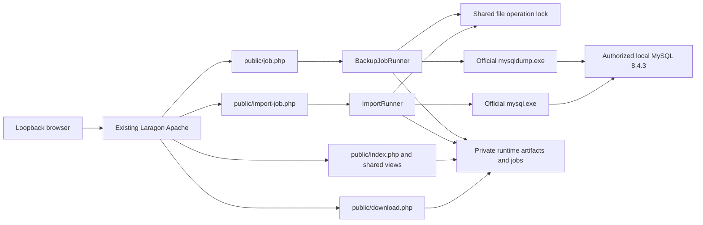
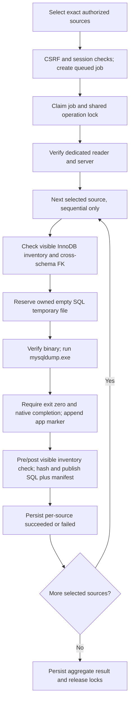
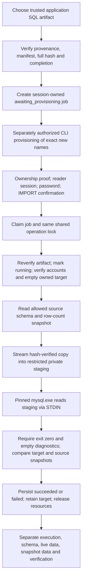

# Architecture — Local MySQL Export / Import Manager

This document describes the **current implemented working tree after cleanup**, not former Restore prototypes or future deployment proposals. Last reviewed: 2026-10-19. See [AGENTS.md](../AGENTS.md) for agent rules, [Local User Guide](LOCAL_USER_GUIDE.md) for operation and [TEST_BASELINE.md](../TEST_BASELINE.md) for measured evidence.

## 1. System overview

A local-only PHP application served by existing Laragon Apache. Navigation is Dashboard / Export / Import / History / Settings. PHP orchestrates the official MySQL clients; it does not serialize table rows into SQL or interpret arbitrary SQL. Files, JSON/JSONL jobs and `flock` supply persistence/coordination; there is no application database, broker, scheduler or background service.



Connections/clients only start in authorized execution paths, not ordinary metadata-only page rendering. The diagram's server is the pinned local instance; it is not permission for automatic live tests.

## 2. Technology and prerequisites

- Windows x64, existing Laragon Apache (current local URL `http://localhost:8081/backUP-phpmyadmin-fordev/`), PHP 8.3 with mysqli/mysqlnd, JSON, sessions, hashing and process functions.
- Fixed Laragon MySQL **8.4.3** client binaries: `C:/laragon/bin/mysql/mysql-8.4.3-winx64/bin/mysqldump.exe` and `C:/laragon/bin/mysql/mysql-8.4.3-winx64/bin/mysql.exe`. These are external prerequisites, not repository artifacts.
- Endpoint `127.0.0.1:3306`, expected native server UUID `198f474e-899b-11f1-903d-f0761cf4041a`; wrong version/hash/UUID/roles/grants/port fail closed.
- Local fixed NTFS private temp outside source root, working hard-link publication on the backup volume, `proc_open` and fixed Windows PowerShell ACL command used by TemporaryMysqlCredentials. No DPAPI helper, .NET build or signing infrastructure is required.
- PHP views + vanilla JavaScript/CSS; no npm/Composer runtime install. Node.js is only needed for the selected JS fixture check. One retained offline acceptance fixture uses PDO SQLite; not required for the website.
- Generic MySQL 8.4 compatibility is **not** enough to pass the current exact pins. This code does not promise MariaDB/other-server portability without a separately reviewed change.

## 3. Project structure

The maintained layout below names existing paths. Runtime children are created by bootstrap during normal use and are deliberately not versioned.

```text
AGENTS.md
README.md
TEST_BASELINE.md
index.php
.htaccess
.gitignore
.gitattributes
app/
  bootstrap.php
  Backup/       native dump, publication, Export jobs/guards
  Import/       native import, target/artifact policy, jobs/comparison/presentation
  Database/     source allowlist, mysqli factory/catalog, shared file lock
  Http/
    Router.php
    Controller/ BackupController.php, SettingsController.php
  Support/      config, runtime paths, access/session/CSRF, views/logging/download
  Restore/      BackupProvenanceIndex.php, RestoreArtifactValidator.php only
config/
  app.php
  local.php.example
public/
  .htaccess
  index.php
  job.php
  import-job.php
  download.php
  assets/       app.css, app.js, backup-jobs.js, local-import.js
views/
  layout.php
  partials/navigation.php
  pages/        dashboard.php, backup.php, import.php, history.php, settings.php, placeholder.php
tests/
  bootstrap.php
  run.php
  js/local-import-presentation.test.js
tools/
  provision-local-import.php
  verify-existing-import.php
  verification/LocalImportAcceptance.php
docs/
  ARCHITECTURE.md
  LOCAL_USER_GUIDE.md
  LOCAL_MYSQL_MANAGER.md
  LOCAL_IMPORT_ACCEPTANCE_2026-10-19.md
  PROJECT_CLEANUP.md
storage/
  .htaccess
```

Optional `config/local.php` and existing storage data stay local. Current PHP test files retain some Phase2/Phase4 names because they test active jobs/UI; a historical filename alone is not proof of dead code. The exact earlier deletion/retention inventory is in PROJECT_CLEANUP.md; its counts are an as-of-cleanup record, not a manifest for this later documentation update.

## 4. Entry points

| Entry point | Responsibility |
|---|---|
| Root `index.php` | Redirect fallback to `public/` when not routed by the root rewrite |
| Root `.htaccess` | Application subdirectory rewrite to public pages/APIs/assets; deny private paths/dotfiles, no indexes |
| `public/index.php` | Page GETs; CSRF-protected connection/settings/session-clear POST actions; metadata inventory and view data |
| `public/job.php` | Export POST create/execute and GET status; CSRF, session ownership and connection-context binding |
| `public/import-job.php` | Import POST prepare/execute and GET status; target overrides rejected; no HTTP provisioning |
| `public/download.php` | Loopback/session-token/list-membership/path/integrity checks before SQL response |
| `tools/provision-local-import.php` | CLI plan-only by default; explicit separately authorized `--apply` provisions exact resources |
| `tools/verify-existing-import.php` | Fixed historical existing-target read-only acceptance inspection, not normal Import execution |

Router accepts exactly `dashboard`, `backup` (label Export), `import`, `history`, `settings`; absent page means Dashboard. Unknown routes render placeholder with404. Deleted Restore endpoints/pages are not supported aliases. Do not recreate them.

## 5. Request/bootstrap/routing flow

1. `app/bootstrap.php` registers the simple `BackupApp\\` filesystem autoloader.
2. `Config::load()` loads base config, optionally merges local config recursively; no environment-secret discovery.
3. `RuntimeDataBootstrap::prepare()` derives/validates paths and creates missing development runtime directories. It must not be invoked against original storage for read-only tooling that promises no writes.
4. PHP error display is disabled; `configureSession()` selects the application session directory, then `Session::start()` uses Strict SameSite, HttpOnly and HTTPS-only Secure flag.
5. Entry points enforce `Auth::isAuthorized()` on the direct remote peer only, not forwarded headers. Configured legacy website hashes cannot authorize LAN clients; website login is retired.
6. POST/status CSRF gates and session job ownership precede execution; pages resolve through Router and render through `View::render()`, shared layout/navigation. External engine creation alone does not open MySQL.
7. Database selection and connection details displayed on ordinary pages come from the current Session. Connecting explicitly uses BackupController and verifies the dedicated reader's exact identity/grants.

Bootstrap currently establishes local session/storage **before** peer rejection; localhost-only access does not imply a zero-side-effect unauthenticated health endpoint. Tests that must preserve storage use isolated copies/temp directories.

## 6. Export flow



`BackupJobAccess` restricts selections to the exact connected allowlist and binds jobs to a session connection context. Duplicate active jobs/claims are rejected. `BackupJobRunner::run()` takes a per-job nonblocking claim and the shared operation lock (blocking for Export), starts one MysqliBackupOperation and processes sources one at a time. A source failure is safely logged/recorded and the next source is attempted; aggregate fails if any source failed. Startup failure fails remaining sources. Finally closes connections and releases locks.

`BackupService::backupDatabase()` checks allowed source, reader/server and visible tables/FK, reserves a random owned `.sql.tmp`, delegates only to MysqldumpEngine, detects visible inventory drift and builds manifest. `MysqldumpEngine::dump()` validates binary path/hash/version, runs the fixed profile and requires empty stderr, native header/completion. It appends the app completion marker; PHP does not build INSERT statements.

Profile: single transaction, quick streaming, skip table locks, no tablespaces, GTID OFF, utf8mb4, hex blobs, UTC, skip triggers/events/routines, no DROP TABLE/add-lock/disable-keys. No `--databases` or all-database directive. Only InnoDB base-table structure+rows; views/non-InnoDB/cross-schema FK reject the job. SELECT-only metadata does not prove excluded objects are absent.

## 7. Import flow



`ImportArtifactVerifier::inspect()` performs bounded manifest/provenance/file-size checks; `verify()` adds full SHA-256/completion check. The browser cannot supply host/port/target/account. `ImportPolicy::names()` generates a cryptographic32-hex job ID, date-bound new target and per-run account. Preparing records no SQL execution.

The external provisioning tool defaults to **plan-only** and receives admin authentication over bounded stdin only after specific authorization. It proves exact target/account absence before creation; records exact creation evidence. It is not invoked by the web app. Future jobs require their own approval; previous target authorization is not reusable.

`ImportRunner::run()` requires awaiting state/ownership, acquires the shared lock nonblocking, verifies immutable artifact binding and persists running before database/client work. `MysqliImportDatabase::start()` verifies exact dedicated target and source reader identities/grants, confirms target exists and has zero tables. It never creates a target. MysqlImportClient verifies binary, stages an immutable SQL copy via streaming hash and invokes mysql.exe for the exact target with binary/batch, disabled system command/local infile/reconnect. Client input is a resource on STDIN, not a shell command.

Import completion requires exit0, empty stdout/stderr and comparison. Failure after start records a safe code and keeps target/account for investigation; errors before start do not claim SQL ran. No automatic retry, overwrite, cleanup, DROP or failed-to-succeeded reconciliation. A process crash/orphaned claim is observed as interrupted, not replayed.

## 8. Job lifecycle and locks

- Export: queued -> running -> succeeded/failed; orphaned execution/connection-context change can become interrupted. Each selected source has its own status/artifact/error; counts are observed facts, not fabricated percentages.
- Import: awaiting_provisioning -> running -> succeeded/failed; orphaned running jobs become interrupted when the claim is obtainable. Store persists append-only JSONL snapshots using file locks; code coordinates allowed entry paths, not a general framework/state-transition engine.
- `BackupExecutionGuard` guards per-job claims and uses injected `FileDatabaseOperationLock`; both production endpoints use `database_operation_lock_path`, derived as `database-operations/global.lock`. Import also has a per-job claim file.
- Export may wait on the shared lock; Import rejects busy. Concurrency remains1.
- Both execute endpoints release the PHP Session lock, set ignore_user_abort and remove PHP time limit before synchronous work. The process adapter still bounds native execution at3600 seconds. Browser/network/Apache timeout is not proof execution failed; inspect persisted status and do not submit again.
- Polling is via existing JS status requests with session+CSRF. No scheduler/background-service queue was added.

## 9. Database policy

`AuthorizedSourcePolicy` is the single exact four-source policy: autoprintdb, drugmap_db, drug_stock_check, prepack_labels. It does not discover a broader allowlist. DatabaseRepository only queries those exact names in INFORMATION_SCHEMA, never unrestricted SHOW DATABASES. `jhcisdb` is prohibited regardless of account capability; other unauthorized sources are rejected.

Source reads preserve data; normal Import writes only the exact newly owned target. Cross-schema foreign keys are unsupported. No remote endpoint or port3333 fallback. Unknown SQL, old custom profiles and untrusted provenance are ineligible, not rewritten to fit.

## 10. Credentials and privileges

| Role | Current boundary |
|---|---|
| Export reader | backup_reader@localhost; USAGE plus exact SELECT on the four escaped source schemas; no extra privileges |
| Import runner | generated per-job localhost account; USAGE plus SELECT, INSERT, CREATE, REFERENCES on exactly its escaped new target |
| Administrator | External explicitly authorized provisioning; not routine website Export/Import and never persisted in app config/jobs |
| Historical inspector | Retained CLI is fixed-scope/read-only and uses interactively supplied admin authentication; it is a separate authorized investigation, not proof that the web runner uses root |

Both actual role checks require expected MySQL version/port/native UUID, CURRENT_USER, CURRENT_ROLE=NONE and partial_revokes=0 with exact grants; extra grants fail. Underscores in grant schema names are escaped under the required semantics.

Reader credentials remain server-side in the PHP Session until session clear/destruction; PHP file sessions are **not encrypted secret storage**. The Import password is per-request and cleared from its form. TemporaryMysqlCredentials writes an ephemeral **plaintext** option file only within a random NTFS directory owned by the runtime SID with protected ACL for that SID and SYSTEM, outside source/web root. No password arguments/environment/logs/job JSON/manifest/API responses. A fixed PowerShell command creates/checks ACL; this is not the removed PowerShell DPAPI worker. Cleanup removes only owned temporary files; machine/process crashes may leave private remnants.

## 11. Artifact/manifest contract

SQL under an authorized source folder has randomized timestamp filename, app completion marker `-- Backup completed successfully`, byte size and SHA-256. Manifest contains database, filename/relative_path, created_at, bytes/hash, complete=true, scope=innodb_tables_structure_and_data, full_database_objects=false, exclusions/visibility limitations, pinned engine/options/result, server identity, snapshot caveats, inventory digest and table count (row count can be null).

Publisher validates pair/hash/marker, writes a create-only temporary manifest, publishes manifest first then SQL using hard-link/unlink no-overwrite semantics and verifies final pair. This is not an atomic two-file transaction; a hard crash between publications can leave a manifest without SQL. Consumers require a valid pair; owned failure cleanup does not delete unrelated old artifacts.

Import additionally requires a succeeded Export job origin matching exact source/path/bytes/hash, producer version/binary/profile/options/server and current file size (maximum16GiB). Full hash is checked before preparation and again during staging. Hash/provenance bind trusted bytes, not arbitrary SQL semantic safety; same Windows-account compromise can forge local evidence.

History metadata inspection does **not** rehash large dumps and never grants verified contents. Legacy metadata inspector remains for old History records only; no provenance backfill. Missing/untrusted/invalid metadata remains visible/ineligible as appropriate.

## 12. Storage paths and ownership

`runtime_data_root` defaults to existing project `storage/`. Derived keys and compatible relative locations:

| Config key | Relative location / purpose |
|---|---|
| backup_path | backups, SQL/manifests |
| job_path | jobs, Export JSONL/claims |
| log_path | logs/app.log |
| restore_job_path | restore-jobs; current Import uses local-import child |
| restore_integration_job_path | restore-integration-jobs, reserved legacy directory only |
| restore_integration_ownership_path | restore-integration-ownership; current Import uses local-import child |
| database_operation_lock_path | database-operations/global.lock |
| backup_database_operation_lock_path / restore_database_operation_lock_path | Compatibility aliases to the same shared lock |
| temporary_path | temporary, reserved application runtime temp mapping |
| session_path | sessions, application PHP file sessions |
| allowed_backup_roots | Derived list containing backup_path |

The existing storage/private directory and old data are protected user data, not a configured secret-provider service. Native clients' private temporary staging uses the OS temp directory via TemporaryMysqlCredentials, **not** temporary_path.

Runtime identity needs read source/config/assets and read/write runtime directories; backup-volume hard links must work. No account/service/ACL deployment is performed by documentation or install instructions. Ownership journal records job ID, exact target/account, expected UUID, new-resource flags and creation time; no prefix inference. Old path names are intentionally retained to avoid a migration.

## 13. Download security

Download endpoint checks direct loopback, Session-derived HMAC token over normalized relative path, SQL inventory membership and contained allowlisted realpath. Completion marker is required; **when a manifest exists**, it also requires complete=true and matching SHA-256. The current legacy compatibility behavior permits marker-bearing files without a manifest to download; that does not make them eligible for Import. Do not describe all old downloads as full manifest-verified.

SQL and private directories are denied direct HTTP access by root rules and storage/.htaccess. No arbitrary download path supplied by user becomes trusted merely by extension. UI tokens do not grant access to a foreign Session's jobs.

## 14. Verification/status meanings

`MysqliImportDatabase::compare()` requires unchanged before/after source metadata/counts and equal target effective table/column/index/FK/check metadata/counts. DDL differs only when EffectiveSchemaComparison proves the observed redundant explicit CHARACTER SET text has identical effective metadata and all other text agrees. Unexplained DDL/source drift fails.

This normal runner checks schema/counts, **not every data value**. Separately, the retained historical inspector/helper compared sorted lossless row multisets (including duplicate multiplicity, NULL/empty, binary/text bytes, precision, supported times and ENUM/SET ordinal evidence) within explicit memory/row bounds. Unsupported types fail closed. Those historical current-source results are not SQL-snapshot comparison.

| UI facet | Meaning |
|---|---|
| Execution completed | Official native client completed in the recorded path; not full verification |
| Schema verified | Available bound schema evidence or normal runner schema/count verification |
| Live-source data verified | Separate bound report proves exact source/target multisets at its inspection timestamp |
| SQL-snapshot data | Currently always NOT VERIFIED |
| Verification pending/failed/partial | Separate from the original persisted job status |

ImportResultPresentation reads only bounded exact-job review files (up to100 candidates,1MiB each), binds job/source/target/artifact fields, checks proof completeness and preserves original failed status. It never executes SQL or edits jobs. Snapshot status cannot be promoted even by an arbitrary report flag.

Evidence reused: Export4/4 and focused39/39, mysql.exe exit0, effective schema9/9, current-source values9/9 (63rows), finalization12/12, cleanup50PASS/1SKIP. Existing job remains failed; overall acceptance **PARTIAL**. Source/target database-default collations differ while existing table/column metadata matches; full database-default/object equivalence is not claimed.

## 15. Errors and logging

Export records safe per-source failures, redacts supplied/session credentials in technical Logger output and continues sequentially. Startup failures fail remaining sources. Import API/runner allowlist safe error-code shapes and return curated Thai guidance; raw SQL/client diagnostics and events are not dumped into UI.

Logger appends normalized single-line exceptions with LOCK_EX; callers must supply all known secrets for redaction. Do not log raw request/password payloads. Import failures persist safe codes; the Import path does not promise every rejection is separately logged to app.log. UI distinguishes unavailable HTTP response from proven execution failure and preserves rejected-request guidance after status refresh. Read status before deciding what happened.

## 16. Configuration reference

| Base key | Default / behavior |
|---|---|
| app_name | PHP MySQL Backup Manager |
| runtime_data_mode | development |
| runtime_data_root | project storage directory |
| max_backup_files | 200 History entries in page controller |
| connect_timeout_seconds | 5 seconds for connection factory |

RuntimeDataBootstrap merges derived paths **after** local config, so independent backup_path/allowed_backup_roots overrides are not supported. Settings selects only validated paths within the derived backup allowlist, storing selection in Session. local.php.example is safe documentation; never commit local.php or database credentials.

Retained production-mode path compatibility accepts only the explicitly approved existing `C:/ProgramData/BackupPhpMyAdmin/RuntimeData` tree with safety validation; it creates no production directory. This is not an approved/current dedicated deployment or a switch to enable automatically. Old auth hashes, if present in a user's local config, do not restore website login. Endpoint/client/hash/UUID/source grants are source policy constants, not freely editable config flags.

## 17. Important classes

| Existing classes (under app/) | Responsibility |
|---|---|
| Backup/BackupService, MysqldumpEngine, MysqldumpCommand | Export orchestration, official profile/binary/reader checks, History inventory |
| Backup/MysqldumpProcess, TemporaryMysqlCredentials | Bounded native process + fixed environment, private temp option files/staging |
| Backup/BackupArtifactPublisher | Pair validation, hash/marker and create-only publishing |
| Backup/BackupJobStore, BackupJobAccess, BackupJobRunner | JSONL state, session/connection-context ownership, sequential execution/recovery |
| Backup/BackupExecutionGuard, BackupJobRequestException | Claim/shared lock coordination, safe HTTP request failures |
| Backup/DumpEngine, BackupOperation | Small adapter interfaces for production and offline fixtures |
| Import/ImportArtifactVerifier, ImportPolicy | Trusted artifact/new target/server/account/grant boundary |
| Import/ImportJobStore, ImportAccess, ImportRunner | Persistent scope/ownership, Session ownership, native Import orchestration |
| Import/MysqlImportClient, MysqliImportDatabase | Official mysql.exe and read-only schema/count snapshots |
| Import/ImportClient, ImportDatabase | Existing adapter contracts |
| Import/EffectiveSchemaComparison, ImportResultPresentation | Evidence-based DDL equivalence and honest independent UI status facets |
| Database/AuthorizedSourcePolicy, DatabaseRepository, ConnectionFactory | Exact source list, scoped catalog, mysqli creation |
| Database/DatabaseOperationLock, FileDatabaseOperationLock | Shared operation exclusion |
| Http/Router, Controller/BackupController, Controller/SettingsController | Page allowlist, reader connection, validated storage selection |
| Support/Config, RuntimeDataPaths, RuntimeDataBootstrap | Config merge and centralized runtime paths/session setup |
| Support/Auth, Session, Security, Request, Flash | Direct-loopback policy, session/CSRF/escaping/input/flash support |
| Support/BackupPathPolicy, DownloadAuthorization | Containment/allowlist and download authorization/integrity |
| Support/View, Logger | Shared PHP rendering and redacted technical logs |
| Restore/BackupProvenanceIndex, RestoreArtifactValidator | Retained origin index + legacy History metadata, no Restore execution |

Class names omit .php in this table; their PSR-like paths under app/ resolve through the existing autoloader. There is no Composer dependency graph to reinstall. See the source for method-level contracts rather than recreating them.

## 18. Supported and unsupported behavior

Supported: local Dashboard/Export/Import/History/Settings; one/multiple/all authorized-source sequential exports; trusted artifact native Import into new owned targets; persistent statuses, metadata history and protected download.

Unsupported: arbitrary SQL upload, old custom dump Import, overwrite-existing DB, broad-source discovery, stored objects/non-InnoDB/full database backup, live Restore framework, scheduler, automatic retry/cleanup/privilege escalation, LAN/remote service, general MariaDB portability or cross-machine pin migration. No removed native/signing/Windows deployment machinery should be rebuilt as a prerequisite.

## 19. Known limitations

- Historical SQL-snapshot values remain NOT VERIFIED; normal Import success is not full data-fidelity evidence.
- SELECT-only object visibility and pre/post table inventory do not prove absence of excluded objects or all concurrent DDL. Single-transaction rows are not a DDL freeze. External writes/drift need separate interpretation.
- Private file sessions and option files are plaintext on local disk under OS/runtime permissions. Same Windows user/admin/process compromise defeats local hashes/provenance/access assumptions.
- No daemon guarantees survival of PHP/Apache/machine termination. Claims/status recovery prevents automatic replay, not restoration of a dead process.
- Partial imports/accounts remain; no broad automatic cleanup or general reconciliation state machine.
- Legacy manifestless download compatibility is weaker than current Import eligibility.
- Process, artifact, metadata/review and comparison bounds can reject large/unsupported cases. Never silently claim verification when a bound is exceeded.
- Git history can retain previously tracked SQL/runtime artifacts even after current-tree index removal. Current-tree hygiene is not history erasure.

## 20. Safe extension/maintenance points

Reuse DumpEngine/BackupOperation and ImportClient/ImportDatabase for targeted offline fixtures; keep one production adapter each. New status facets belong in ImportResultPresentation/views with evidence tests. Extend EffectiveSchemaComparison only with effective-metadata proof and regression fixtures, never broad textual normalization.

Any change to pins, server/grants, supported SQL profile, overwrite/target/cleanup behavior or snapshot proof needs its own explicit safety review/authorization; do not add a parallel engine or relax gates for convenience. Trace actual callers, change minimally, run focused offline checks, update affected docs/baseline. Read historical acceptance before making claims. No future feature is promised by this section.
